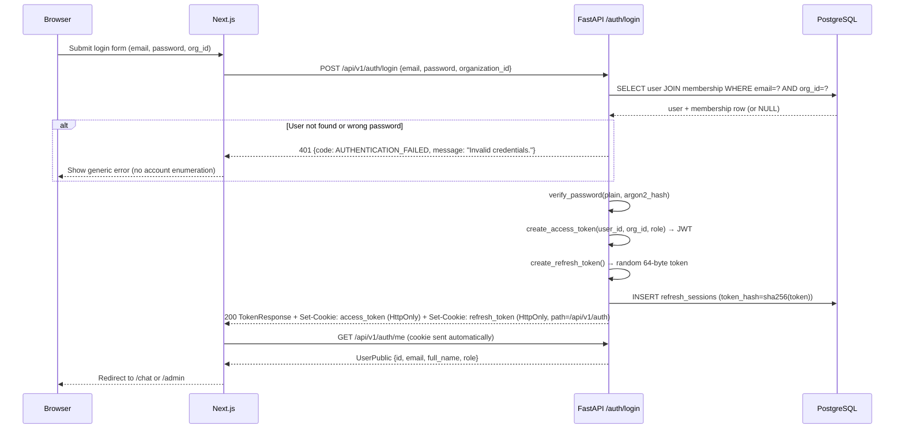
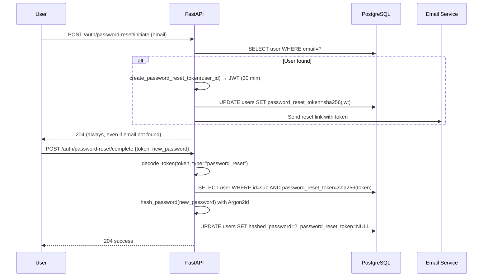

# Authentication Flow — FIKRA AI

## Login sequence

## Token lifecycle

| Token | Type | Storage | Expiry | Revocation |
|-------|------|---------|--------|------------|
| Access token | Signed JWT | HttpOnly cookie | 30 min (config) | Stateless; wait for expiry |
| Refresh token | Random opaque string | HttpOnly cookie (path=/api/v1/auth) | 7 days (config) | Server-side: `refresh_sessions.is_revoked=true` |

## Security properties

- **No localStorage**: Both tokens are HttpOnly cookies. JavaScript cannot read them. XSS cannot steal them.
- **SameSite=Strict**: CSRF protection. Cookies are not sent on cross-site requests.
- **Argon2id**: Memory-hard password hashing (64MB, 3 iterations, 4 parallelism). Resistant to GPU cracking.
- **Constant-time comparison**: `passlib.verify()` uses a constant-time algorithm.
- **Generic errors**: Login and password-reset responses never reveal whether an email exists.
- **Refresh token rotation**: Each refresh issues a new token and revokes the old one.
- **Password rehashing**: If a stored hash uses outdated parameters, it is transparently re-hashed on next login.

## Password reset flow

