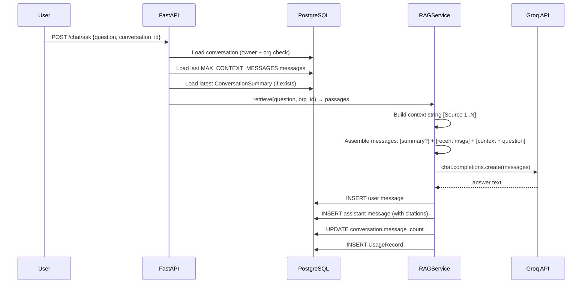

# Conversation Memory — FIKRA AI

## Overview

Each conversation persists across sessions. When a user sends a new message the
system assembles a bounded context window from:

1. The existing conversation summary (if any)
2. The most recent N messages (`MAX_CONTEXT_MESSAGES`, default 20)
3. Retrieved document passages for the current question

This keeps LLM input costs bounded while preserving useful context.

---

## Context assembly flow



---

## When summarization triggers

Summarization is triggered when `conversation.message_count >= SUMMARIZE_AFTER_MESSAGES`
(default 30). At that point:

1. The oldest messages (beyond the recent window) are compressed into a single
   `ConversationSummary` record.
2. Future context assembly uses the summary text instead of the individual old messages.
3. The summary is stored in `conversation_summaries` with a reference to the
   last message it covers (`covers_up_to_message_id`).

**Important**: Summarization is not yet fully implemented in the MVP. The scaffold
exists (`ConversationSummary` model, `memory_service.py` placeholder). A Phase 7
task activates it when `message_count` crosses the threshold.

---

## Token budget enforcement

| Budget | Config key | Default |
|--------|-----------|---------|
| Total LLM input | `MAX_INPUT_TOKENS` | 6000 |
| LLM output | `MAX_OUTPUT_TOKENS` | 2048 |
| Recent messages | `MAX_CONTEXT_MESSAGES` | 20 |
| Summarize after | `SUMMARIZE_AFTER_MESSAGES` | 30 |

The context is assembled in this priority order:
1. System prompt (fixed, ~200 tokens)
2. Conversation summary (variable, ~300 tokens)
3. Recent messages (bounded)
4. Retrieved passages (bounded by `RERANKER_TOP_N × 1000 chars`)
5. Current question

If the assembled context would exceed `MAX_INPUT_TOKENS`, older messages are
dropped first, then retrieved passages are trimmed.

---

## Data model

```
conversations
  id, organization_id, user_id, title, message_count

messages
  id, conversation_id, organization_id, user_id
  role (user | assistant | system)
  content
  citations (JSONB)
  model_used, input_tokens, output_tokens, latency_ms

conversation_summaries
  id, conversation_id, organization_id
  summary_text
  covers_up_to_message_id
  message_count_covered
```

---

## Tenant isolation for memory

- Conversations are scoped by both `user_id` and `organization_id`.
- A user cannot read another user's conversation even within the same org.
- Organization memberships are checked on every request.
- Deletion cascades: deleting a conversation deletes all messages and summaries.
- `UsageRecord` rows are retained for billing/audit; they contain no message content.
