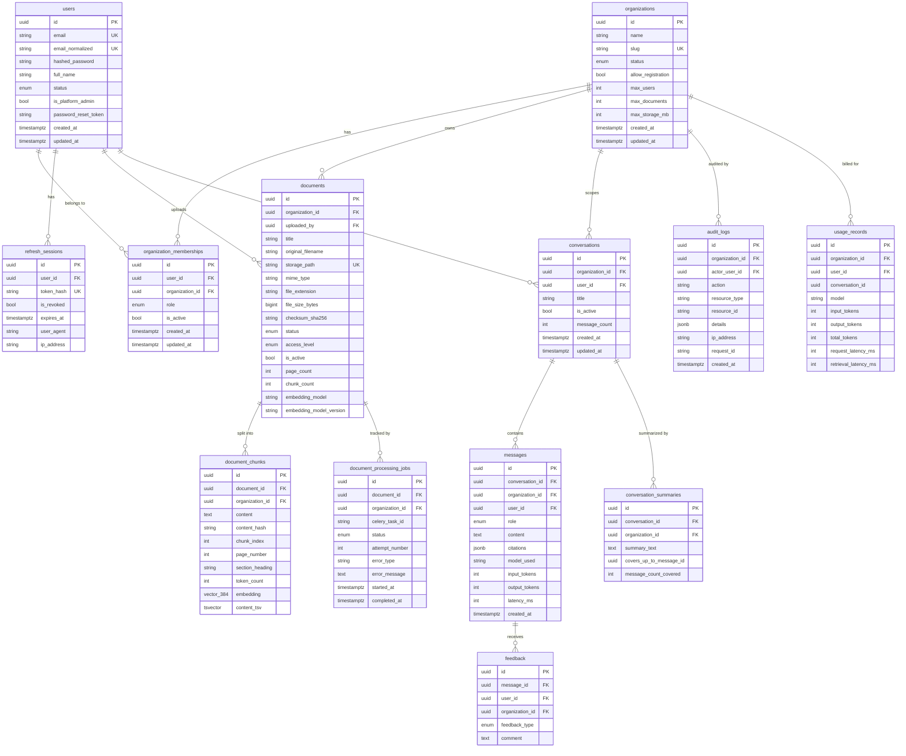

# Database Entity-Relationship Diagram

## Entity overview



---

## Key design notes

### Tenant ownership
Every table except `users` and `refresh_sessions` has `organization_id`.
`document_chunks` has a denormalized `organization_id` to avoid a JOIN during vector search.

### Embedding column
`document_chunks.embedding` is a `vector(384)` column (pgvector).
The dimension **must match** `EMBEDDING_DIMENSIONS` in config.
Changing the embedding model requires updating this column definition and reindexing.

An IVFFlat index with `lists=100` is created at migration time:
```sql
CREATE INDEX ix_chunks_embedding_ivfflat
ON document_chunks USING ivfflat (embedding vector_cosine_ops)
WITH (lists = 100);
```

### Full-text search
`document_chunks.content_tsv` is a `tsvector GENERATED ALWAYS AS STORED` column.
It is automatically updated when `content` changes.
A GIN index enables fast FTS queries.

### Citations storage
`messages.citations` is JSONB — a list of citation objects. Each object contains:
`source_number`, `document_id`, `document_title`, `page_number`, `section_heading`, `excerpt`.

Citations are written by the server after validating them against the source map.
The model cannot inject unauthorized document references.

### Deletion behaviour
| Parent deleted | Child behaviour |
|---------------|----------------|
| Organization | CASCADE → all owned resources |
| User | CASCADE → memberships, conversations, messages, feedback; SET NULL → documents.uploaded_by |
| Document | CASCADE → chunks, processing jobs |
| Conversation | CASCADE → messages, summaries |
| Message | CASCADE → feedback |

### Indexes
All `organization_id`, `user_id`, and `status` columns are indexed.
`document_chunks.content_tsv` has a GIN index.
`document_chunks.embedding` has an IVFFlat index.
`users.email_normalized` has a unique index for fast login lookups.
