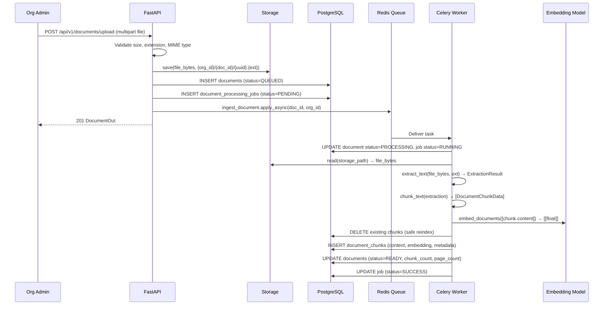

# Document Ingestion Pipeline — FIKRA AI

## Pipeline overview

## Upload validation

Before any file is saved:

1. **Size check**: `len(file_bytes) > MAX_UPLOAD_SIZE_BYTES` → 400 FileTooLarge
2. **Extension check**: `ext not in ALLOWED_EXTENSIONS` → 400 InvalidFileType
3. **MIME detection**: `python-magic` reads the first 4096 bytes to detect actual file type (ignores Content-Type header from client)
4. **Storage path**: Generated as `{org_id}/{doc_id}/{uuid}.{ext}` — never uses the user-supplied filename in the path

## Extraction

| Format | Library | Notes |
|--------|---------|-------|
| PDF | PyMuPDF | Page-by-page extraction; OCR fallback if text < 50 chars |
| Scanned PDF | Tesseract via pytesseract | Rendered at 150 DPI |
| DOCX | python-docx | Paragraphs + heading detection |
| Markdown | markdown + BeautifulSoup | HTML conversion then text extraction |
| HTML | BeautifulSoup | Strips script/style/nav/footer |
| TXT | Python decode | UTF-8 with error replace |

**Warnings** are stored in `documents.extraction_warnings` (JSONB). They are visible to admins but not shown to end users as raw errors.

## Chunking strategy

- Split pages into paragraphs (double-newline boundaries).
- Greedily fill chunks up to `MAX_CHUNK_TOKENS` (default 400 tokens).
- Token count estimated as `words * 1.3` (conservative; avoids tiktoken dependency for development).
- Overlap: the last paragraph of the previous chunk is prepended to the next.
- Each chunk stores: `chunk_index`, `page_number`, `section_heading`, `start_char`, `end_char`, `token_count`, `content_hash`.

## Embedding

- Model: `BAAI/bge-small-en-v1.5` (384 dimensions, Apache 2.0 license).
- Loaded once at worker startup, reused across all tasks.
- Batched by `EMBEDDING_BATCH_SIZE` (default 32).
- Vectors normalized to unit length.
- `embedding_model` and `embedding_model_version` (SHA-256 prefix of model name) stored on the document record.
- If you change the embedding model, set all affected documents to `status=PENDING` and reindex.

## Retry policy

| Attempt | Delay |
|---------|-------|
| 1 | Immediate |
| 2 | 60 seconds |
| 3 | 120 seconds |
| Dead | Job status = DEAD, document status = FAILED |

Failed jobs are visible to org admins at `GET /api/v1/documents/{id}/status`. Admins can trigger reindex with `POST /api/v1/documents/{id}/reindex`.

Raw exception tracebacks are logged at ERROR level but stored only as `error_type` + first 256 chars of `error_message` in the database — never exposed to users.
