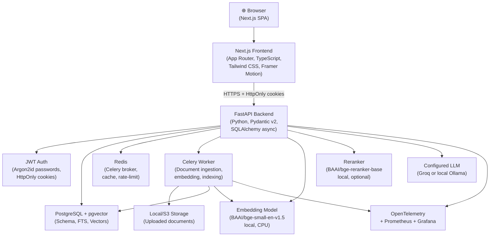

# System Overview — FIKRA AI

## What is FIKRA AI?

FIKRA AI is a **production-grade, multi-tenant Retrieval-Augmented Generation (RAG) chatbot**. It lets organizations upload their own documents and then ask natural-language questions. The system retrieves relevant document passages and generates a grounded answer using a Groq-hosted large language model (LLM), with validated citations pointing back to the source documents.

---

## High-level architecture

**Synchronous path** (blue): Browser → Frontend → Backend → PostgreSQL/LLM → response
**Asynchronous path** (orange): Upload → Backend → Redis queue → Worker → Storage → DB

---

## Multi-tenancy model

Every resource in the system belongs to exactly one **Organization**. Organizations are completely isolated:

- Database rows carry an `organization_id` foreign key.
- Every query filters by `organization_id` derived from the authenticated JWT.
- pgvector searches include `organization_id` in the WHERE clause — not as a post-filter.
- Redis keys are namespaced by tenant.
- Object storage paths are namespaced by `{org_id}/{doc_id}/`.
- Background jobs re-verify `organization_id` against the database when they execute.

Frontend-supplied tenant IDs are **never trusted**. The tenant identity comes from the server-side JWT claim.

---

## User roles

| Role | Scope | Key capabilities |
|------|-------|-----------------|
| Member | Organization | Chat, view documents, manage own conversations |
| Org Admin | Organization | + Upload/delete documents, manage users, view metrics |
| Platform Admin | All orgs | + Manage organizations, platform config, support ops |

---

## Technology decisions (summary)

| Component | Choice | Reason |
|-----------|--------|--------|
| Backend | FastAPI + Python | Async-native, excellent ML ecosystem |
| ORM | SQLAlchemy 2.x async | Type-safe, supports pgvector |
| Vector DB | pgvector (PostgreSQL) | No extra service, ACID + vectors |
| LLM | Groq (llama3-8b-8192) | Fast hosted inference, generous rate limits |
| Embeddings | BAAI/bge-small-en-v1.5 | 384 dims, strong English retrieval, free, local |
| Frontend | Next.js 14 + App Router | SSR, file-based routing, ecosystem |
| Auth | JWT + Argon2id | Industry standard; HttpOnly cookies prevent XSS token theft |
| Queue | Celery + Redis | Mature, observable, retry semantics |

Full rationale in `docs/decisions/`.
